<picture>
  <source media="(prefers-color-scheme: dark)" srcset="./dark-profile-ascii.svg">
  <source media="(prefers-color-scheme: light)" srcset="./light-profile-ascii.svg">
  
</picture>
---

### 🌍 Open Source Contributions

Contributing improvements to [Kestra](https://github.com/kestra-io/kestra), an open-source workflow orchestration platform.

- ✅ **[Merged PR #21157](https://github.com/kestra-io/kestra/pull/21157)** — Improved dashboard selector truncation by replacing the legacy Bootstrap utility with Kestra's `KsText` component.
- 🔄 **[Open PR #21807](https://github.com/kestra-io/kestra/pull/21807)** — Proposed safer metadata cleanup after failed AI flow and dashboard generation, with regression tests.
